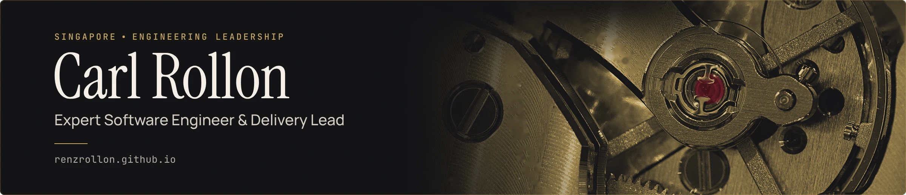

I lead engineering teams and build the harness that lets them ship from a spec. 14+ years of enterprise and AI-enabled platforms in regulated industries; Expert Software Engineer & Delivery Lead at Zühlke, Singapore. Lately: tooling that gives coding agents one human checkpoint and nothing to ask after it.

## The toolchain

spec → [Checkpoint](https://github.com/renzrollon/checkpoint) (you read it on your phone) → [Escapement](https://github.com/renzrollon/escapement) (queues it overnight) → [Interlock](https://github.com/renzrollon/interlock) (ships it) → a tested commit by morning.

- **[Interlock](https://github.com/renzrollon/interlock)**: spec-driven development for Claude Code, layered on OpenSpec. You read one spec; parallel agents ship it to a tested commit. Zero runtime dependencies. [Watch one run](https://github.com/renzrollon/interlock/releases/download/v1.5.0/interlock-spec-and-ship-full.mp4) (2:34): 12 tasks, 2 waves, 19 agents, 180/180 tests, one commit.
- **[Shippable Skills](https://github.com/renzrollon/shippable-skills)**: agent skills for Cursor, Copilot, Codex and Claude Code, each linted, evaluated and security-scanned before release. `npx skills add renzrollon/shippable-skills`
- **[Escapement](https://github.com/renzrollon/escapement)** (in progress): drains a queue of approved changes overnight, one background session per ship, one push to your phone per stop.
- **[Checkpoint](https://github.com/renzrollon/checkpoint)** (in progress): a phone-sized inbox for the one decision an unattended run cannot make. The git host is the message bus.

## Recent releases

<!-- releases:start -->
- [interlock v1.9.0](https://github.com/renzrollon/interlock/releases/tag/v1.9.0) · 2026-10-25
- [shippable-skills v0.1.0](https://github.com/renzrollon/shippable-skills/releases/tag/v0.1.0) · 2026-08-21
<!-- releases:end -->

## How I build

One human checkpoint, at the spec. Zero-touch is a property of the runtime, not a promise in a prompt. Degradations are announced, never silent.

## Before the tooling

Delivery lead for multi-team consulting engagements, including five years anchoring five consultants across three client teams (and acting Scrum Master for all three), and technical direction for an AI-assisted development platform used by non-engineers. Hands-on throughout: a core-banking platform moved to Azure, Kafka streaming and Python ETL at scale, auditable data migrations across markets. Lead and Java roles before that, 2013 to 2021.

AWS Solutions Architect · CKAD · Confluent Kafka Developer · PSM II · SAFe DevOps · PCAP · B.S. Computer Science, cum laude, University of the Philippines.

[CV](https://renzrollon.github.io/) · [LinkedIn](https://www.linkedin.com/in/carlrollon/) · [carl.rollon@gmail.com](mailto:carl.rollon@gmail.com) · Open to engineering leadership roles.
